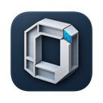

# Open BIM

Открытое desktop-приложение на Rust для моделирования и деталировки строительных конструкций. Разработка начинается со стали на macOS ARM64, затем добавляются бетон и арматура.

**Текущее состояние (0.1.0): первый стальной сценарий — модель, соединения, нумерация, коллизии, чертежи (PDF/DXF/SVG), ведомости, обмен IFC4, 100 000 объектов в 3D-виде. Бетон и арматура пока не реализованы. Это не полный аналог коммерческих программ для КМД.** Итог проверки: [финальный аудит](docs/final-audit.md). Подтверждённое покрытие и открытые задачи перечислены в [матрице](docs/parity.csv).

## Запуск

Требования: macOS ARM64, Rust 1.99.0 (rustup), доступ к crates.io для первой сборки. После загрузки зависимостей приложение работает офлайн.

```sh
cargo run --locked -p open-bim-desktop
```

Если системный линкер не распознаёт `arm64e.x1` в SDK 27, а SDK 26.5 установлен, задайте перед командами локальную переменную процесса:

```sh
export SDKROOT=/Library/Developer/CommandLineTools/SDKs/MacOSX26.5.sdk
```

На текущем хосте сборка проверяется с этой настройкой. На исправной системе она не требуется.

## Сборка приложения macOS

```sh
scripts/package-macos.sh
```

Создаёт `dist/Open BIM.app` и zip-архив (без подписи и нотаризации, см. [релизы](docs/releases.md)).
Основной значок приложения — объёмная буква **O** из профилей с голубой узловой
пластиной. Один исходник используется в macOS (`.icns`), Windows (`.ico`) и Linux
(PNG); исходник и размеры находятся в [`assets/icons`](assets/icons/README.md).
Управление с клавиатуры: ⌘P — поиск команд, F1 — все горячие клавиши, F2/F3/F4 — модель/чертежи/ведомости.

## Упаковка для Windows и Linux

На Windows с Rust MSVC, Visual Studio Build Tools / Windows SDK и PowerShell 7:

```powershell
./scripts/package-windows.ps1
```

В `dist/` создаётся ZIP с EXE, содержащим значок приложения, и примерами моделей.

На Linux с Rust, C/C++ toolchain, pkg-config и пакетами разработки Wayland,
xkbcommon и Vulkan (Ubuntu: `libwayland-dev libxkbcommon-dev libvulkan-dev`):

```sh
scripts/package-linux.sh
```

Распакуйте архив из `dist/` и запустите внутри `./install.sh`: приложение и ярлык
с основным значком установятся в `~/.local`. Для другого каталога передайте
абсолютный префикс: `./install.sh /path/to/prefix`. Оконные бэкенды X11 и Wayland
включены для Linux; для выбора файлов нужен работающий `xdg-desktop-portal`
с бэкендом окружения рабочего стола.

Все три упаковки также доступны через ручной запуск workflow
`Native application packages` в GitHub Actions. Локальная проверка на macOS
не подтверждает работу приложения на Windows и Linux; для этого нужны нативные
сборки и запуск на соответствующих системах.

## Пример стального выпуска

Каркас → соединения → нумерация → комплект чертежей → спецификации на модели
`tests/fixtures/steel_release/source.obim` (16 деталей, 6 узлов, созданных в GUI):

```sh
cargo run --release --locked -p open-bim-desktop -- --open tests/fixtures/steel_release/source.obim
```

В приложении: **F4 Ведомости** → «Сборки по заводским швам» → «Выпустить комплект»
(общий вид A1, чертежи сборок и деталей по позициям, PDF и CSV в папку `release`);
**F3 Чертежи** — редактирование листов; **⌘K** в модели — нумерация и коллизии;
⌘S — сохранить. Тот же выпуск без GUI:

```sh
cargo run --release --locked -p open-bim-reports --bin open-bim-release -- tests/fixtures/steel_release/source.obim release --auto-assemblies --save release/project.obim
```

Подробности: [выпуск стали](docs/steel-release.md), [чертежи](docs/drawings.md).

## Проверки

```sh
cargo build --workspace --locked
cargo test --workspace --locked
cargo fmt --all --check
cargo clippy --workspace --all-targets --locked -- -D warnings
```

Проверены геометрическое ядро, модель BIM, транзакции undo/redo, формат проекта с аварийным восстановлением и GPU-вид. Для контрольного каркаса добавьте `-- --example` к команде запуска. В интерфейсе работают камера, выбор, видимость и сечение, числовое создание осей, балок, колонн и контурных плит, перемещение, копирование, поворот, зеркало, свойства и сохранение/открытие `.obim`. Инструменты этапа 7 проверены автоматическими тестами и сценариями настоящего GUI. См. [моделирование](docs/modeling.md). См. [управление 3D-видом](docs/viewport.md).

См. [архитектуру](docs/architecture.md), [источники зависимостей](docs/dependencies.md) и [лицензию](LICENSE). Проект независимый.
