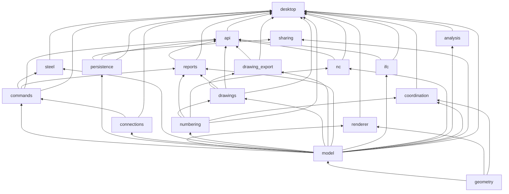

# Архитектура Open BIM

Карта кода на `main` после появления единой модели взаимодействия. Единицы модели — миллиметры, `f64`. GUI и GPU не задают геометрическую точность: вид переводит тела в `f32` только в момент показа, от локального начала. Ранняя заметка `docs/architecture.md` описывает слои этапа 1 и отстала от кода; актуальная карта — этот файл.

Программа — desktop-приложение на Rust (egui + wgpu) для стального и железобетонного каркаса: модель, узлы, чертежи КМ/КМД, ведомости, IFC и NC. Цель владельца — чтобы на macOS можно было моделировать конструкции, не покупая Tekla.

## Крейты

| Крейт | Зачем |
|---|---|
| `geometry` | Тела, допуски, сетки. Ядро — truck (`truck-modeling`, `truck-topology`); булевы операции — вендоренный `vendor/truck-shapeops` (патч описан в `vendor/truck-shapeops/PATCH.md`). |
| `model` | Домен BIM: проект, идентификаторы, детали, профили, материалы, сетка, узлы, чертежи как данные, семейства, бетон, расчётные свойства. Не знает про GUI и GPU. |
| `commands` | Транзакции над `Project`: команда, проверка, откат, журнал undo/redo. После коммита узлы пересобираются (`connections`). |
| `persistence` | Файл `.obim`: магия `open-bim-project`, версия, контрольная сумма, атомарная запись, журнал автосохранения. |
| `renderer` | Сцена из проекта, камера, режим отображения, выбор лучом, оверлей (сетка, ручки, резиновая нить, знак привязки). |
| `steel` | Болтовые группы и связанные отверстия как набор команд. |
| `connections` | Рецепты узлов (опорная плита, торец, уголок, фасонка, вут, стык, столик, свои компоненты) без привязки к конкретным ID до вставки. |
| `numbering` | Позиции деталей и марок по геометрической эквивалентности, не по ID. |
| `coordination` | Коллизии: широкая фаза по габаритам, затем пересечение сеток. |
| `drawings` | Листы из ссылок на модель. Нарисованное не хранится как геометрия модели; у листа виды, размеры и отпечатки для проверки «устарел». |
| `drawing_export` | PDF, DXF, SVG и проверка наложения подписей. |
| `reports` | Ведомости и выпуск комплекта из модели и нумерации. |
| `ifc` | Импорт и экспорт заявленного подмножества IFC4 и IFC4.3. |
| `nc` | DSTV `.nc1` по маркам. |
| `analysis` | Расчётная схема (стержни, узлы, связи, нагрузки) считается из физической модели. Решателя нет. |
| `api` | Объектный API и пакетный режим: вставка отдельно от `commit`, запись на диск отдельно от фиксации. |
| `sharing` | Общая папка: ревизии, блокировки, трёхстороннее слияние. Сервера нет. Библиотека собрана и покрыта тестами; ни `desktop`, ни `api` на неё не ссылаются, команд «Совместная работа» в интерфейсе нет (текст `docs/collaboration.md` описывает задуманный сценарий). |
| `desktop` | Русский интерфейс, лента, сеанс моделирования, привязки, сборка команд в транзакции. |

## Зависимости

Направление одностороннее: интерфейс знает домен, домен не знает интерфейс. `commands` зависит от `connections`, потому что коммит пересобирает узлы. `desktop` собирает все прикладные крейты.



`sharing` на схеме висит отдельно: его вызывают только собственные тесты. Проверка границы «model не тянет GUI» — `cargo tree -p open-bim-model`.

## Модель данных

Корень — `Project` (`crates/model/src/project.rs`). У каждого объекта `ObjectId` (`u64`, ноль запрещён). `next_id` больше любого ID своего диапазона; в общей модели диапазоны по `ID_BLOCK`, чтобы два инженера не выдавали один и тот же номер.

Что лежит в проекте:

- **Материалы и профили.** `Material`, `Profile` (`catalog.rs`). Новый проект в приложении начинается со стали С255 и пяти профилей ГОСТ (30Б1, уголок, швеллер, труба, гнутый профиль) плюс брус. Полный сортамент — `library` и таблицы `data/reference`. `Project::default` в тестах по-прежнему держит аналитические сечения без скруглений.
- **Элементы.** `Element`: имя, материал, свойства, форма. Форма — `Member` (балка или колонна: профиль, длина, `Frame`, «Положение») или `Plate` (контур в локальной плоскости, толщина, `Frame`). Опорная линия и положение сечения разделены: смена профиля не двигает линию (`position.rs`).
- **Сетка.** `GridAxis` (отрезок с именем) и `Level` (имя и отметка). Прямоугольная сетка по умолчанию — 1–5 × А–Г с шагом 6000 мм, уровни 0 и +3600 (`interaction/tools.rs`). Отдельного объекта «радиальная сетка» нет. Линии рисуются и ловятся на каждой отметке, но хранятся один раз.
- **Сборки.** Явный главный элемент, детали и дочерние сборки. Один объект не входит в две сборки.
- **Деталировка.** `Detail`: отверстия, вырезы, болтовые группы, швы. Болты и швы ссылаются на детали.
- **Узлы.** `ConnectionInstance` ссылается на шаблон и родителей; дети пересобираются при изменении родителей.
- **Построения.** Вспомогательные точки, линии, окружности и размеры модели. На чертежи сами по себе не попадают.
- **Семейства, пользовательские сечения, гнутые детали, бетон, арматура, захватки, опалубка** — отдельные карты в том же `Project`.
- **Чертежи и выпуск.** `Drawing` хранит определение листа, не картинку. Нумерация, изменения по ГОСТ и основная надпись тоже в проекте.
- **Расчёт.** `Analysis`: нагрузки, группы, связи, роли деталей. Стержневая схема при запросе считается заново и в файл как отдельная геометрия не пишется.
- **Управление и совместная работа.** Стадии, задания, блокировки, иерархия здания.

Инварианты, которые держат команды: ID переживает правку и сохранение; ошибочный ввод не оставляет половины изменения; повреждённая геометрия — это ошибка, а не «примерно получилось».

## Интерфейс, вид и команды

Цепочка щелчка:

1. `desktop` (`eframe`) рисует ленту, панели и центральный вид. Кнопка ленты — это `Cmd` из реестра `ui/commands.rs`, не отдельный обработчик на каждой кнопке.
2. `Workbench::execute` либо меняет режим (открыть инструмент, панель, диалог), либо возвращает `Request`. Создание и правка геометрии заканчиваются списком `Command`.
3. `Document::transact` (`commands`) применяет список атомарно, пишет шаг undo и пересобирает зависимые узлы. Откат — обратный шаг.
4. Из нового `Project` собирается `renderer::Scene`: тела в сетки, габариты, BVH для выбора. GPU рисует сцену; оверлей (`renderer/overlay.rs`) рисует сетку, ручки, нить и знак привязки уже в пикселях.

Привязки вида — `interaction/snap.rs`: кандидаты у луча курсора, приоритет класса, затем расстояние в пикселях. Отдельно `tools/snap.rs` — индекс отрезков в миллиметрах для числовых инструментов и тестов; на экране его не вызывают.

Сбор точек исторически размазан по нескольким автоматам: `interaction::Engine` (балка, колонна, пластина, ось), `trim` (вырезы, подгонка, косынка, построения), `detail` (болт и шов), `edit_pick` и `special` (перенос, копия, массив), плюс измерение, рабочая плоскость, вставка, секущая плоскость. У каждого свой текст шага. Это и есть ощущение «набора команд»: механика шагов похожа, а оболочка каждый раз своя.

Поверх них лежит сеанс `interaction/workflow.rs`. Он не заменяет автоматы, а задаёт общие правила:

- покой — **выбор**;
- инструмент — временный режим со своей панелью свойств и живой подсказкой;
- **Esc** возвращает к выбору (в том числе закрывает окно гнутой детали);
- строка состояния в покое говорит, какого шага каркаса ещё нет.

## IFC и расчёт

**IFC** (`crates/ifc`) не участвует в щелчке. Экспорт пишет заявленное подмножество (балки, колонны, пластины, проёмы, профили, материалы, GUID, наборы свойств; схема IFC4 или IFC4.3 ADD2). Импорт читает IFC2x3, IFC4 и IFC4.3, в том числе сооружения 4.3, и складывает распознанное в ту же модель. Нераспознанное остаётся отчётом, а не молчаливым успехом. Команды ленты — «Импорт IFC», «Экспорт IFC», «Экспорт IFC4.3», «Преобразовать объекты IFC». Подробности покрытия — `docs/ifc-support.md`.

**Расчёт** (`crates/analysis` и вкладка «РАСЧЁТ И ПРОЕКТИРОВАНИЕ») строит узлы в концах и пересечениях стержней, сами стержни, жёсткие связи и нагрузки выбранных групп. Нагрузки и роли хранятся в `Project.analysis`. Решателя и экспорта в расчётную программу нет: схема нужна, чтобы задать граничные условия рядом с физической моделью, а не чтобы получить усилия.

## Сборка, тесты, CI

Тулчейн закреплён в `rust-toolchain.toml`: Rust **1.99.0**, edition 2024. `cargo build/test --workspace --locked`. В debug у своего кода `opt-level = 1`, у зависимостей `2`: булевы операции и ведомости иначе слишком медленные для тестов. `unsafe` запрещён на уровне workspace.

Локально перед сдачей:

```sh
cargo fmt --all --check
cargo clippy --workspace --all-targets --locked -- -D warnings
cargo test --workspace --locked
```

CI (`.github/workflows/ci.yml`) на каждый push и pull request:

| Задача | Хост | Что гоняет |
|---|---|---|
| macOS ARM64 | `macos-15`, проверка `uname -m` | сборка, тесты, `fmt --check`, clippy `-D warnings` |
| Linux x86_64 | `ubuntu-24.04` | сборка, тесты `--no-fail-fast`, clippy. `CARGO_PROFILE_DEV_DEBUG=0`, инкрементальная сборка выключена |
| Windows x86_64 | `windows-2025` | то же и `scripts/package-windows.ps1`, артефакт zip |

`fmt` обязателен только на macOS: там в тулчейн ставится rustfmt. Linux и Windows ставят clippy без rustfmt.

Приложение: `cargo run --locked -p open-bim-desktop`. Пакет macOS — `scripts/package-macos.sh` (без подписи).

## Как сейчас моделирует инженер

Новый проект уже со сеткой 1–5 × А–Г и уровнями 0 / +3,600, со сталью С255 и профилем 30Б1. Покой — выбор: щелчок, рамка слева направо (целиком внутри) и справа налево (касание), Shift добавляет, Ctrl переключает.

Дальше строка состояния называет следующий шаг по тому, чего в модели нет:

1. Нет осей — «Сетка».
2. Есть оси, нет колонн — колонна, один щелчок в узел. Низ и верх сами садятся на соседние уровни (не на крышу здания), если высоту ещё не вводили.
3. Есть колонны, нет балок — балка, два щелчка.
4. Есть балки, нет пластин — контурная пластина (Enter замыкает) либо сразу узлы.
5. Есть пластины или каркас без узлов — каталог компонентов.
6. Есть узлы, нет листов — вкладка чертежей.
7. Есть листы — правка выбором и повторный выпуск.

Кнопка «Дальше: …» на пустой панели свойств запускает тот же `Cmd`, что и лента. Лента «МЕТАЛЛ» идёт в том же порядке: оси и уровни, колонны и балки, пластины, узлы, сборка. Сетка по-прежнему есть и на «ПРАВКА», среди построений.

Пока команда собирает точки, панель справа — свойства **инструмента** (профиль, материал, положение, уровни колонны), а не прошлой выборки. В строке — текст шага и «Esc — вернуться к выбору». Команда после объекта вооружается снова, пока не нажать Esc. Отмена последнего щелчка — Backspace, не Esc.

Уже работает и этим слоем не заменяется: привязки (концы, середины, пересечения сетки, перпендикуляр, параллель, продолжение), орто, фиксация X/Y/Z, числовой ввод (`x,y,z`, `@`, `$`, `!`, полярная запись, R/A/G), копирование специальное (в том числе несколько копий одним undo), перенос и зеркало, ручки концов, undo/redo, фильтр выбора.

## Где относительно Tekla всё ещё неудобно

Сравнение по коду, не по памяти о чужой программе. То, что уже совпадает (двухщелчковая балка, узлы сетки, орто, числовой ввод, копирование N раз), здесь не повторяется.

Ощущение «набора команд» давали не отсутствующие кнопки, а оболочка:

- Шаги собирают **разные** автоматы (`Engine`, `trim`, `detail`, `edit_pick`, `special`, измерение, плоскость). Подсказки были правильные по шагу, но в покое строка говорила «выберите команду на ленте», а не что делать с этим каркасом.
- Лента «МЕТАЛЛ» начиналась с перемешанных деталей; сетка лежала на «ПРАВКА» в группе построений. Порядок работы приходилось помнить.
- Колонна по умолчанию имела абсолютные 0 и 3600, а после создания уровень только показывался. Сейчас низ и верх хранятся в модели и правятся в панели.
- Окно гнутой балки Esc не закрывал, хотя остальные инструменты Esc прерывает.
- Панель свойств при старте балки или колонны не обязана была открываться: болт её открывал, балка — нет.

Сеанс закрывает эти пять пунктов. Дальше модель хранит намерение там, где оно однозначное: конец колонны помнит уровень и смещение (`level_ends`, формат файла 2), типоразмер помнит профиль и то, что экземпляр переопределил. Временный размер до оси живёт только на экране. Проверка модели — список, не окно на каждый коммит.

Ниже — то, что в коде по-прежнему слабее ожидания конструктора:

- **Привязка плана к осям** (X/Y колонны к сетке) не хранится. К уровням привязаны только низ и верх.
- **Сетка.** Нет радиальной сетки, нет выбора начала сетки щелчком, нет отдельного объекта «одна линия сетки» со своей ручкой. Линии на всех отметках — это сдвиг одних и тех же осей.
- **Копирование свойств** с одной детали на другие и **обмен начала и конца** балки (чтобы «слева» значило другую сторону) в реестре команд отсутствуют.
- **Вставка** есть внутри сеанса (`interaction/clipboard.rs`), но это снимок модели в памяти, не обмен между двумя открытыми проектами.
- Глубина привязки «Авто / Плоскость» и плоскость вида в тулбаре уже есть (`Switches::depth_plane`). Старые строки `docs/interaction.md` и `docs/reference-docs-comparison.md`, где написано, что глубины нет, отстали от кода.

## Целевая модель взаимодействия

Модель, под которую теперь собрана оболочка. Реализация — `crates/desktop/src/interaction/workflow.rs`, лента «МЕТАЛЛ» и строка состояния в `ui/chrome.rs`.

Четыре правила на все команды, старые автоматы не переписывались:

1. **Выбор — дом.** Нет активной команды → можно выделять и править свойства. Esc из команды возвращает сюда. Esc без команды снимает выделение (как и раньше).
2. **Инструмент — режим, не диалог «создать».** Выбрали команду, панель справа показывает её свойства, вид ждёт точки, нить и привязка живые, объект появляется на последней точке, команда остаётся вооружённой.
3. **Один следующий шаг.** Пока точек не собираем, строка состояния и пустая панель свойств называют один следующий этап каркаса и кнопку, которая его начинает. Отказ («сначала выберите объекты») остаётся впереди подсказки: его нужно прочитать.
4. **Порядок ленты совпадает с порядком работы:** оси и уровни → колонны и балки → пластины → узлы → сборка. Чертежи, ведомости и обмен — свои вкладки, на них указывает шаг 6, а не дублирующая пачка кнопок на «МЕТАЛЛ».

Умолчания, чтобы обычный каркас не требовал лишнего ввода: сетка и С255 / 30Б1 уже в новом проекте; стальная колонна с нетронутыми полями 0 и 3600 сажается на нижний уровень и следующий над ним, смещение 0. Введённая высота и файл свойств не затираются. Бетонные сечения сохраняют свои размеры.

### Как существующие команды ложатся на модель

| Этап | Поза | Команды | Что видит инженер |
|---|---|---|---|
| Оси и уровни | Диалог, не точки | `GridDialog` («Сетка»). `ToolAxis` — две точки, тот же автомат, что у балки | Окно сетки: строки X/Y, отметки Z, подписи. Ось — нить между двумя точками |
| Колонны | Инструмент, один щелчок | `ToolColumn`, `ConcreteColumn`, `ConcreteFooting` | Панель: профиль или сечение, низ и верх. Щелчок в узел ставит колонну и оставляет команду |
| Балки | Инструмент, два щелчка | `ToolBeam`, `ToolTwin`. `ToolCurvedBeam`, `ToolPolyBeam` — окно, Esc его закрывает | Панель положения и профиля до первого щелчка. Сдвоенный профиль — та же балка с вторым стержнем |
| Пластины | Инструмент, контур | `ToolPlate`, `ToolGusset`, `ToolStiffener`, `ToolBentPlate` (окно) | Точки контура, длины сторон на оверлее, Enter или средняя кнопка замыкает |
| Узлы и крепёж | Инструмент со своими точками | `ComponentCatalog`, `AutoConnections`, `PanelConnections`, `ToolBolt`, `ToolWeld`, `ToolWeldPolygon`, `ToolWeldOnPart` | Каталог или подсказка «укажите главную деталь». Свойства болта открываются в той же панели |
| Правка | Выбор, затем инструмент | `MoveByPicks`, `CopyByPicks`, `CopySpecial`, `MirrorByPicks`, `RotateByPicks`, `Paste`, ручки, «Изменить» на панели | Без выборки команда отказывается и говорит об этом. Несколько копий — один undo |
| Чертежи и выпуск | Другой режим окна, не точки модели | `ModeDrawings`, `NumberAndCheck`, `PartDrawing`, `ReleaseSet`, `ExportPdf`, `ExportIfc`, `ExportNc` | Вкладка «ЧЕРТЕЖИ И ОТЧЁТЫ» и «УПРАВЛЕНИЕ». Модель на этом шаге уже стоит |

Выбор, привязка, рабочая плоскость, измерение и вид — не этапы каркаса. Они доступны всегда: привязка работает внутри любого инструмента, измерение и секущая плоскость сами являются короткими инструментами с тем же Esc.

Что модель сознательно не делает видом «ещё одной команды»: не прячет каталог узлов внутрь пластины, не ставит узлы сама в конце балки, не переключает вкладку чертежей без щелчка. Подсказка говорит, куда идти; решение остаётся за инженером.
